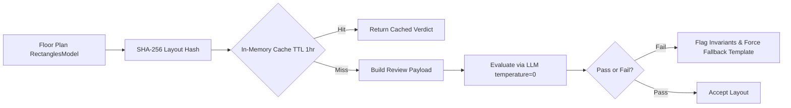

# AI Pipeline & Adapter Architecture
> `Groq` • `Gemini` • `Ollama` • `JSON-Mode` • `Placement Reasoner` • `Layout Critic`

Deep-dive into the BuildWise AI engine architecture (`app/ai/`). Details the adapter pattern, strict JSON-mode enforcement, prompt engineering, multi-layer fallback chains, spatial placement reasoning, and the architectural layout critic.

---

## Table of Contents
- [Architecture Overview](#architecture-overview)
- [Adapter Pattern & Base Interface](#adapter-pattern--base-interface)
- [Provider Implementations](#provider-implementations)
  - [1. Groq Adapter (`GroqExplanationAdapter`)](#1-groq-adapter-groqexplanationadapter)
  - [2. Google Gemini Adapter (`GeminiExplanationAdapter`)](#2-google-gemini-adapter-geminiexplanationadapter)
  - [3. Local Ollama Adapter (`OllamaExplanationAdapter`)](#3-local-ollama-adapter-ollamaexplanationadapter)
  - [4. Deterministic Mock Adapter (`MockExplanationAdapter`)](#4-deterministic-mock-adapter-mockexplanationadapter)
- [Prompts & JSON Schema Enforcement](#prompts--json-schema-enforcement)
- [Architect Placement Reasoner](#architect-placement-reasoner)
- [Architectural Layout Critic & Caching](#architectural-layout-critic--caching)
- [Resilience & Fallback Matrix](#resilience--fallback-matrix)
- [Navigation](#navigation)

---

## Architecture Overview

BuildWise AI separates **civil calculations** from **natural language synthesis and spatial reasoning**:
1. **Deterministic Core:** Topography, MCDA scoring, CPWD DSR cost rates, IS 1893 seismic factors, and Vastu orientation are computed mathematically first.
2. **AI Reasoning Layer:** An LLM adapter interprets the deterministic metrics, generates technical commentary, synthesizes room programs, and reviews layouts.
3. **Pydantic Validation & Fallback:** If an LLM times out, hallucinates invalid JSON, or violates schema bounds, the pipeline transparently falls back to the deterministic local mock adapter with detailed telemetry annotations.

```mermaid
flowchart TD
    Data[Deterministic Analysis Payload] --> Factory[get_ai_adapter(provider)]
    Factory --> Adapter{Provider Choice}
    Adapter -->|Groq| GroqAd[GroqExplanationAdapter]
    Adapter -->|Gemini| GemAd[GeminiExplanationAdapter]
    Adapter -->|Ollama| OllAd[OllamaExplanationAdapter]
    Adapter -->|Mock| MockAd[MockExplanationAdapter]

    GroqAd --> CallGroq[httpx POST api.groq.com]
    GemAd --> CallGem[httpx POST generativelanguage.googleapis.com]
    OllamaAd --> CallOll[httpx POST localhost:11434]

    CallGroq -- Error / Timeout --> Fallback[Mock Fallback]
    CallGem -- Error / Timeout --> Fallback
    CallOll -- Error / Timeout --> Fallback

    CallGroq -- 200 OK --> Parse[Regex JSON Extractor]
    CallGem -- 200 OK --> Parse

    Parse --> Validate{Pydantic Schema Validation}
    Validate -- Valid --> Out[Return Commentary & Recs]
    Validate -- ValidationError --> Fallback
    Fallback --> Out
```

---

## Adapter Pattern & Base Interface

All adapters implement the abstract base interface defined in `app/ai/base_adapter.py`:

```python
class BaseExplanationAdapter(ABC):
    @abstractmethod
    async def generate_explanation(
        self,
        analysis_data: Dict[str, Any]
    ) -> Tuple[str, List[str], Dict[str, str]]:
        """
        Returns:
            - summary: Executive civil engineering summary string.
            - recommendations: List of structural/architectural action items.
            - metadata: Telemetry dictionary (provider_used, latency_seconds, model_name, etc.).
        """
        pass
```

Factory instantiation via `app.ai.get_ai_adapter(provider_name)` returns the appropriate instance.

---

## Provider Implementations

### 1. Groq Adapter (`GroqExplanationAdapter`)
Located in `app/ai/groq_adapter.py`.
- **Default Model:** `llama-3.3-70b-versatile`
- **Fallback Candidate List:**
  1. User-configured `GROQ_MODEL`
  2. `llama-3.3-70b-versatile`
  3. `llama-3.1-8b-instant`
- **JSON Enforcement:** Sends `"response_format": {"type": "json_object"}`.
- **Payload Extraction:** Extracts text bounded by the first `{` and last `}` using `re.search(r'\{.*\}', raw_content, re.DOTALL)`.
- **Latency:** ~0.6s to 1.5s for 70B parameter models.

### 2. Google Gemini Adapter (`GeminiExplanationAdapter`)
Located in `app/ai/gemini_adapter.py`.
- **Default Model:** `gemini-2.5-flash-lite`
- **Candidate Models:**
  1. `gemini-2.5-flash-lite`
  2. `gemini-3.5-flash-lite`
  3. `gemini-3.6-flash`
  4. `gemini-1.5-flash`
- **Schema Transformation:** Google Gemini REST API rejects standard JSON Schema keywords such as `additionalProperties`, `title`, and `default`. The `to_gemini_schema()` helper translates Pydantic's JSON schema into Gemini's `responseSchema` proto format.
- **REST Endpoint:** `https://generativelanguage.googleapis.com/v1beta/models/{target_model}:generateContent?key={api_key}`.

### 3. Local Ollama Adapter (`OllamaExplanationAdapter`)
Located in `app/ai/ollama_adapter.py`.
- **Default Endpoint:** `http://localhost:11434/api/generate` (configurable via `OLLAMA_BASE_URL`).
- **Default Model:** `llama3.2` (or `mistral`).
- Enables 100% offline, air-gapped engineering analysis with zero external network connectivity.

### 4. Deterministic Mock Adapter (`MockExplanationAdapter`)
Located in `app/ai/mock_adapter.py`.
- **Zero External Dependencies:** Requires no API keys and no internet connection.
- **Deterministic Math:** Evaluates inputs using CPWD DSR schedules, IS 1893 seismic tables, and Indian NBC rules.
- **Speed:** Sub-millisecond execution (< 1ms).

---

## Prompts & JSON Schema Enforcement

### System Prompt (`app/ai/prompts.py`)
```text
You are an elite Indian Civil and Structural Engineer AI, specializing in
CPWD (Central Public Works Department) benchmarks, IS 456 (Concrete),
IS 1893 (Seismic), and NBC 2016 (National Building Code).

Your task is to analyze a construction site based on the provided user parameters
and generate a strict, mathematically sound feasibility report.

RULES:
1. MATHEMATICAL ACCURACY: If the user provides a Plinth Area of 2,000 sq ft and a
   'Premium' grade (approx ₹3,500/sqft), the total base cost MUST be close to ₹70,00,000.
   Do not hallucinate random numbers. Calculate them.
2. PARAMETER REFLECTION: Your analysis must explicitly reflect the inputs.
   If 'Storeys' is G+3, you must recommend deeper foundations (e.g., pile or raft)
   compared to G+1 (isolated footings).
3. SEISMIC ZONE: Use the provided Latitude/Longitude to infer the likely Seismic Zone
   (II, III, IV, or V) per IS 1893 and adjust structural recommendations accordingly.
4. NO FLUFF: Output ONLY valid JSON matching the provided schema. No markdown,
   no introductory text.
```

### Standardized User Prompt
```text
Analyze this site: Lat={lat}, Lon={lon}, Area={area} sqft, Grade={grade}, Typology={typology}, Storeys={storeys}, Ground Coverage={coverage}%.
```

---

## Architect Placement Reasoner

Located in `app/ai/placement_reasoner.py`.

Before the spatial dissection engine places rooms on a grid, the LLM placement reasoner is invoked at `temperature=0` to determine room bands and functional adjacencies:
- **Input:** Required room types, plot dimensions, frontage orientation, Vastu entrance preferences, and solar axis.
- **Output:** JSON mapping of room types to depth bands (`front`, `middle`, `rear`, `flank`), target zones, and door connection rules.
- **Safety Gate:** The raw LLM response is **never** passed directly to the solver. It is piped through `validate_and_repair_placement()` in `app/placement/validator.py`, which deterministically enforces the Knowledge Base rules (e.g. forcing Pooja away from Bathrooms and clamping Living to the front band).

---

## Architectural Layout Critic & Caching

Located in `app/ai/layout_critic.py`.

Once the Dissection Engine solves the floor plan geometry, the **Layout Critic** performs an independent architectural audit.



### In-Memory Cache
- Caches results by `SHA-256` digest of rounded room coordinates and door connections.
- **TTL:** 1 hour (`3600.0` seconds).
- Identical floor plan layouts bypass external API calls entirely.

### Critic Checks:
1. No bathrooms or kitchens positioned centrally or acting as through-passages.
2. No narrow strip rooms (width $< 2.4\text{ m}$).
3. Direct exterior ventilation for all wet rooms.
4. No primary circulation traversing private bedrooms.

---

## Resilience & Fallback Matrix

| Failure Mode | Trigger | System Behavior | User Impact |
|:---|:---|:---|:---|
| **Missing API Key** | Empty `GROQ_API_KEY` / `GEMINI_API_KEY` | Routes to `MockExplanationAdapter` | Instant result; `provider_used="mock_fallback"` |
| **API Timeout / 5xx** | Groq/Gemini API down or latency > 12s | Catches exception, falls back to Mock | Request completes; warning appended to response |
| **Malformed JSON** | Model emits markdown or incomplete JSON | Regex extractor attempts extraction; falls back to Mock on syntax error | Zero UI crash; fallback explanation rendered |
| **Pydantic ValidationError** | Model output deviates from schema types | Discards invalid output, falls back to Mock with sanitized types | Validated response returned; warning logged |
| **Critic Rejection** | Critic detects architectural rule violation | Re-solves geometry using forced canonical reference template | Flawless floor plan geometry guaranteed |

---

## Navigation
- **Previous:** [← Backend API Reference](backend-api.md)
- **Next:** [Generative Blueprint Engine →](blueprint-engine.md)

---
*BuildWise AI • [MIT License](../LICENSE) • Copyright (c) 2026 Rolan Lobo*
