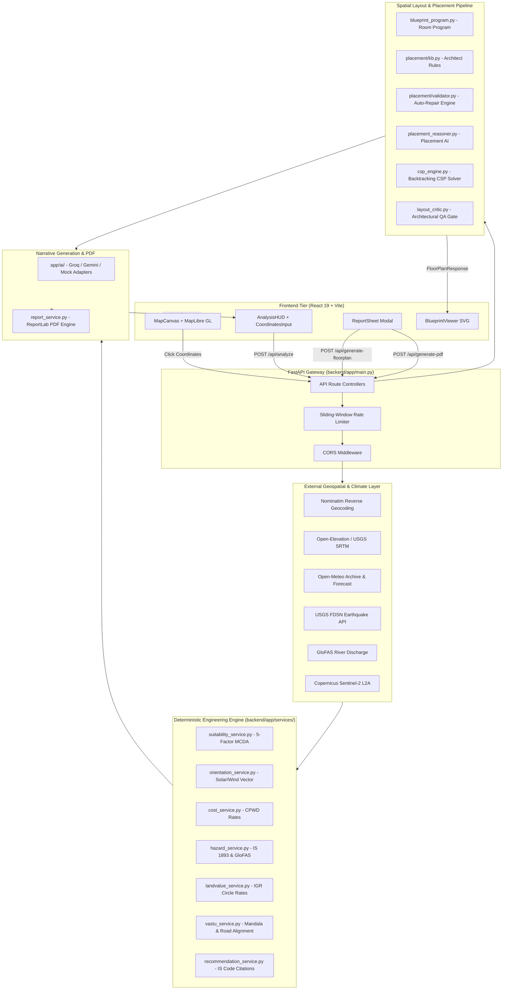
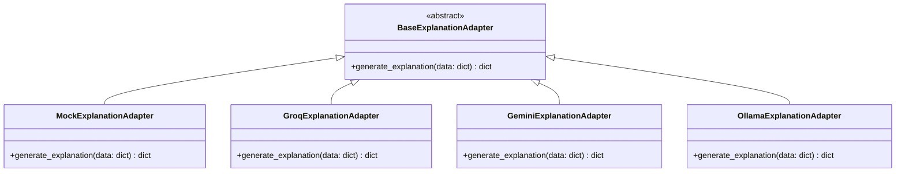

# System Architecture

[](../LICENSE)
[](../backend)
[](../frontend)

High-level architecture, module decomposition, and end-to-end request lifecycle across the BuildWise AI platform.

---

## Table of Contents

- [System Overview](#system-overview)
- [Architecture Diagram](#architecture-diagram)
- [Request Lifecycle of `/api/analyze`](#request-lifecycle-of-apianalyze)
- [Module Map](#module-map)
  - [Backend Structure (`backend/app/`)](#backend-structure-backendapp)
  - [Frontend Structure (`frontend/src/`)](#frontend-structure-frontendsrc)
- [Decoupled Adapter Architecture](#decoupled-adapter-architecture)
- [Next Steps](#next-steps)

---

## System Overview

BuildWise AI is structured around a **two-tier sovereign micro-architecture**:
1. **Interactive Geospatial Presentation Tier (`frontend/`):** React 19 application powered by Vite, TailwindCSS, and MapLibre GL. Implements an Apple iOS-style glassmorphism interface with native SVG vector rendering.
2. **Deterministic Engineering Core & AI Gateway Tier (`backend/`):** FastAPI application executing multi-criteria decision analysis (MCDA), Indian Standard (IS) civil codes, CPWD cost schedules, spatial constraint satisfaction (CSP), and LLM narrative adapters.

---

## Architecture Diagram



---

## Request Lifecycle of `/api/analyze`

When a user selects a site coordinate on the map canvas, `/api/analyze` executes the following sequence:

```
User Selects Site
      │
      ▼
1. Rate Limit Gate ──► Verify client IP within 30 req / 60 sec sliding window
      │
      ▼
2. Telemetry Ingestion (Parallel async fetch with fallback guards)
      ├── Reverse Geocoding (Nominatim / Coordinate fallback)
      ├── Digital Elevation Model (AMSL & slope calculation)
      └── Microclimate Data (Temperature, monsoon rainfall, prevailing wind)
      │
      ▼
3. Deterministic Engineering Core
      ├── MCDA Suitability (Slope 25%, Flood 20%, Road 20%, Facility 20%, Comfort 15%)
      ├── Bioclimatic Orientation (Optimal passive solar angle & ventilation axis)
      ├── CPWD Cost Estimator (Plinth rate benchmarks adjusted for slope & grade)
      ├── Hazard Analysis (IS 1893:2016 Seismic Zone + USGS historical earthquakes)
      ├── River Discharge Modeling (GloFAS river flow ratio & local depression index)
      ├── Land Valuation (IGR circle rate spatial matching + locality multiplier)
      ├── Vastu Advisory (Mandala cardinal room matrix + road approach angle)
      └── Traceable Recommendations (Severity-ranked items with IS code references)
      │
      ▼
4. LLM Narrative Synthesis
      ├── Provider Factory (Groq llama-3.3-70b / Gemini 2.5 Flash / Mock)
      ├── Strict JSON Mode Execution
      └── Pydantic Schema Enforcement
      │
      ▼
5. Client Delivery
      └── Unified AnalysisResponse (Score, Verdict, Factors, Costs, Hazards, Vastu)
```

---

## Module Map

### Backend Structure (`backend/app/`)

```
backend/app/
├── ai/                          # AI narrative & placement adapters
│   ├── base_adapter.py          # Abstract Base Class for LLM providers
│   ├── blueprint_program.py     # Room program generator from client notes
│   ├── gemini_adapter.py        # Google Gemini 2.5 Flash implementation
│   ├── groq_adapter.py          # Groq Cloud (Llama 3.3 70B) implementation
│   ├── layout_critic.py         # LLM layout verification loop
│   ├── mock_adapter.py          # Deterministic zero-key fallback generator
│   ├── ollama_adapter.py        # Local Ollama client adapter
│   └── placement_reasoner.py    # Architectural placement reasoner
├── placement/                   # Architectural Placement Engine v13
│   ├── kb.py                    # Codified knowledge base (NBC 2016 rules)
│   └── validator.py             # Deterministic verification & auto-repair
├── schemas/                     # Strict Pydantic models
│   ├── floorplan.py             # FloorPlanRequest, Response, QA, Geometry
│   ├── request.py               # AnalysisRequest, ReportRequest
│   ├── response.py              # AnalysisResponse, FactorScore, CostEstimate
│   ├── room_program.py          # RoomProgram, RoomSpec, SolverHints
│   └── site_vision.py           # SiteVisionRequest, SiteVisionResponse
├── services/                    # Civil engineering calculation core
│   ├── floorplan/               # Continuous geometry floor plan engine
│   │   ├── constraints.py       # QA gate & adjacency prohibition matrix
│   │   ├── engine.py            # Sole geometry engine (envelope-first)
│   │   ├── floorplan_service.py # Floor plan orchestration service
│   │   └── grid_model.py        # NBC 2016 room area catalog
│   ├── cost_service.py          # CPWD plinth area cost schedule
│   ├── external_data_service.py # Nominatim, elevation, Open-Meteo clients
│   ├── hazard_service.py        # IS 1893 seismic & GloFAS river discharge
│   ├── landvalue_service.py     # Circle rate spatial matcher & multiplier
│   ├── orientation_service.py   # Passive solar & aerodynamic azimuth
│   ├── recommendation_service.py# Ranked engineering actions with IS codes
│   ├── report_service.py        # ReportLab vector PDF compilation
│   ├── suitability_service.py   # 5-factor weighted MCDA matrix
│   ├── vastu_service.py         # 9-zone Vastu Purusha Mandala
│   └── vision/                  # Copernicus Sentinel-2 satellite analysis
├── config.py                    # Pydantic Settings & environment parsing
└── main.py                      # FastAPI app entry point & routes
```

### Frontend Structure (`frontend/src/`)

```
frontend/src/
├── components/                  # UI Component inventory
│   ├── AnalysisForm.tsx         # Sidebar configuration drawer
│   ├── AnalysisHUD.tsx          # Floating iOS-style metric pill HUD
│   ├── AppHeader.tsx            # Header bar with theme toggle & provider badge
│   ├── BlueprintViewer.tsx      # Dual CAD/Paper vector SVG floor plan viewer
│   ├── CoordinatesInput.tsx     # Direct WGS84 latitude/longitude input
│   ├── CostBreakdownTable.tsx   # CPWD civil works line item table
│   ├── DataSourcesDisclosure.tsx# Open data attribution & terms disclosure
│   ├── DownloadReportButton.tsx # Client-side PDF fetch & download trigger
│   ├── EmptyState.tsx           # Initial map landing guide
│   ├── FactorBreakdown.tsx      # MCDA suitability factor progress bars
│   ├── FloorPlanGeneratorCard.tsx# Generative floor plan designer with placement logic
│   ├── HazardProfileCard.tsx    # Seismic, flood, and extreme weather cards
│   ├── Icon.tsx                 # Unified Lucide-inspired SVG icon system
│   ├── IosSelect.tsx            # Apple iOS-style custom popover select
│   ├── LandValueCard.tsx        # Indicative circle rates & outlay calculator
│   ├── MapCanvas.tsx            # MapLibre GL map viewport with 3D buildings
│   ├── MapStyleSelector.tsx     # Standard / Satellite / Terrain style switcher
│   ├── MethodologyModal.tsx     # Full mathematical & code methodology disclosure
│   ├── OrientationCompass.tsx   # Interactive solar & aerodynamic compass
│   ├── RecommendationPanel.tsx  # Categorized actions with IS-code badges
│   ├── ReportHeroBand.tsx       # Full-bleed scorecard banner in ReportSheet
│   ├── ReportSheet.tsx          # Full-screen modal report dossier
│   ├── RiskMatrix.tsx           # Severity-ranked risk assessment table
│   ├── ScoreSummaryCard.tsx     # Primary suitability score donut
│   ├── SiteVisionCard.tsx       # Sentinel-2 ecological vegetation radar
│   ├── StatusBanner.tsx         # Degraded service & fallback warnings
│   └── VastuAdvisoryCard.tsx    # Mandala 9-zone grid & entrance ranking
├── services/                    # API clients and TypeScript declarations
│   ├── api.ts                   # Axios client targeting backend endpoints
│   └── types.ts                 # TypeScript types mirroring Pydantic schemas
├── App.tsx                      # Root orchestration component
├── index.css                    # Design system tokens, vibrancy, and Tailwind
└── main.tsx                     # React DOM entry point
```

---

## Decoupled Adapter Architecture

BuildWise AI decouples engineering calculations from AI narrative synthesis using the **Strategy Pattern**:



- When external keys are absent, `MockExplanationAdapter` computes verified, deterministic text in `< 5ms`.
- When `GROQ_API_KEY` or `GEMINI_API_KEY` is supplied, the platform executes zero-temperature structured JSON requests with automatic failover to `MockExplanationAdapter` on timeout or rate limiting.

---

## Next Steps

- Learn about [Frontend Design Tokens & Components](frontend.md)
- Review the [Backend API Reference](backend-api.md)
- Deep dive into the [AI Pipeline & Adapters](ai-pipeline.md)

---

[← Previous: Getting Started](getting-started.md) | [Next: Frontend Architecture →](frontend.md)

### License

Distributed under the MIT License. See [LICENSE](../LICENSE) for details.
