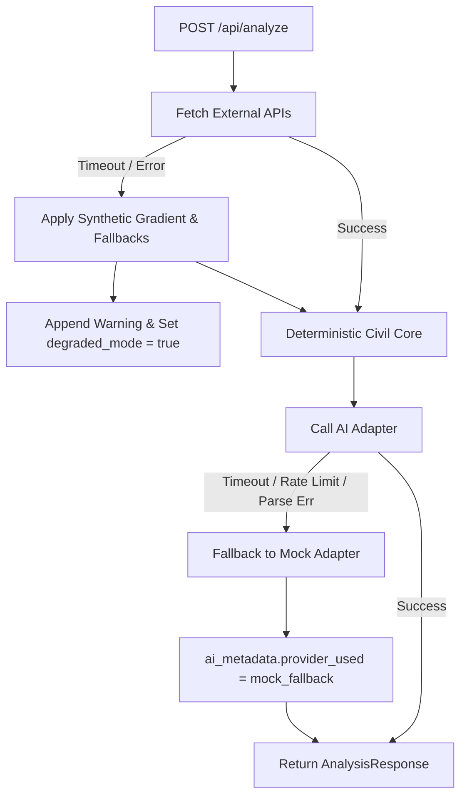

# Backend API Reference
> `FastAPI` • `REST` • `JSON Mode` • `Pydantic v2` • `Rate Limiting`

Comprehensive reference for the BuildWise AI backend service (`app.main:app`). Covers REST endpoints, request/response contracts, rate limiting, CORS configuration, and the fallback/degraded mode specification.

---

## Table of Contents
- [Overview](#overview)
- [Base URL & Middleware](#base-url--middleware)
  - [CORS Policy](#cors-policy)
  - [Rate Limiting](#rate-limiting)
- [Endpoints](#endpoints)
  - [1. GET /api/status](#1-get-apistatus)
  - [2. GET /api/health](#2-get-apihealth)
  - [3. POST /api/analyze](#3-post-apianalyze)
  - [4. POST /api/site-vision](#4-post-apisite-vision)
  - [5. POST /api/generate-floorplan](#5-post-apigenerate-floorplan)
  - [6. POST /api/report](#6-post-apireport)
- [Error & Fallback Contract](#error--fallback-contract)
- [Navigation](#navigation)

---

## Overview

The backend is built with **FastAPI** and uses **Pydantic v2** models for bidirectional serialization and schema validation. All civil calculation services, spatial constraint solvers, and AI adapters communicate synchronously or asynchronously through strict schemas.

```
Frontend (Vite / React)
   │
   ├── GET  /api/status               -> Engine status & active API key flags
   ├── GET  /api/health               -> Health check & AI adapter inventory
   ├── POST /api/analyze              -> Multi-criteria site feasibility & engineering analysis
   ├── POST /api/site-vision          -> Sentinel-2 multispectral ecological analysis
   ├── POST /api/generate-floorplan   -> CSP & Dissection architectural layout engine
   └── POST /api/report               -> High-res ReportLab vector PDF generator
```

---

## Base URL & Middleware

By default, the backend listens at `http://127.0.0.1:8000` (or `http://localhost:8000`).

### CORS Policy
The backend enforces explicit origin matching in `app/main.py`:
- `http://localhost:5173`
- `http://127.0.0.1:5173`
- Any additional origins defined in the `CORS_ORIGINS` environment variable (e.g. `https://your-domain.com`).

```python
app.add_middleware(
    CORSMiddleware,
    allow_origins=ALLOWED_ORIGINS,
    allow_credentials=True,
    allow_methods=["*"],
    allow_headers=["*"],
)
```

### Rate Limiting
To prevent denial of service and API abuse, a sliding-window rate limiter guards heavy endpoints:
- **Limit:** 30 requests per 60 seconds per IP address (`RATE_LIMIT_MAX_REQUESTS = 30`, `RATE_LIMIT_WINDOW_SEC = 60.0`).
- **Response:** `HTTP 429 Too Many Requests`
- **Error Payload:**
  ```json
  {
    "detail": "Rate limit exceeded (maximum 30 requests per minute). Please wait before running another analysis."
  }
  ```

---

## Endpoints

### 1. GET /api/status

Lightweight health status endpoint indicating configured LLM keys and system availability.

#### Request
```http
GET /api/status HTTP/1.1
Host: localhost:8000
```

#### Response (`HTTP 200 OK`)
```json
{
  "status": "online",
  "groq": true,
  "gemini": true,
  "default_provider": "groq"
}
```

---

### 2. GET /api/health

System diagnostics endpoint returning detailed runtime versioning and active AI adapters.

#### Request
```http
GET /api/health HTTP/1.1
Host: localhost:8000
```

#### Response (`HTTP 200 OK`)
```json
{
  "status": "healthy",
  "version": "1.1.0",
  "ai_adapters_available": ["mock", "groq", "gemini", "ollama"],
  "active_default_ai": "groq"
}
```

---

### 3. POST /api/analyze

The primary site engineering analysis endpoint. Executes reverse geocoding, digital elevation sampling, microclimate querying, MCDA suitability scoring, orientation calculation, CPWD cost estimation, seismic & flood hazard profiling, indicative land valuation, Vastu advisory, and AI engineering commentary.

#### Request Payload (`AnalysisRequest`)
```json
{
  "latitude": 12.9716,
  "longitude": 77.5946,
  "built_up_area_sqft": 2000.0,
  "quality_grade": "standard",
  "building_typology": "residential_single",
  "floors": 2,
  "ground_coverage_ratio": 0.60,
  "override_land_rate_per_sqft": null,
  "plot_area_sqft": 3000.0,
  "ai_provider": "groq"
}
```

#### Key Fields:
- `latitude` / `longitude` *(float, required)*: WGS84 decimal coordinates.
- `built_up_area_sqft` *(float, default: 2000.0)*: Planned gross floor area across all storeys.
- `quality_grade` *(string, default: "standard")*: `"economy"`, `"standard"`, `"premium"`, or `"luxury"`.
  It drives the **finish schedule and cost rates** only (door/window finishes, wall
  and floor specification, CPWD rate band). It does **not** change room geometry,
  clear dimensions or the plate; a premium grade is not a larger plan (audit F19).
- `building_typology` *(string, default: "residential_single")*: Typology identifier.
- `floors` *(int, default: 1)*: Total number of storeys (e.g. 1 = G, 2 = G+1).
- `ground_coverage_ratio` *(float, optional)*: Maximum building footprint ratio (0.1 to 1.0).
- `override_land_rate_per_sqft` *(float, optional)*: User-defined circle rate override in INR/sqft.
- `ai_provider` *(string, optional)*: `"groq"`, `"gemini"`, `"ollama"`, or `"mock"`.

#### Response Payload (`AnalysisResponse`)
```json
{
  "request_id": "BW-A1B2C3D4",
  "timestamp": "2026-09-24T17:15:00.000000+00:00",
  "coordinates": {
    "latitude": 12.9716,
    "longitude": 77.5946
  },
  "formatted_address": "Bengaluru, Karnataka, India",
  "overall_suitability_score": 82.4,
  "suitability_verdict": "Highly Feasible",
  "feasibility_score": 82,
  "parameter_reflection": "Site analysis reflects 2,000 sq ft built-up area with Standard specification grade and G+1 storeys.",
  "degraded_mode": false,
  "warnings": [],
  "factors": [
    {
      "factor_id": "topography",
      "name": "Topographic Slope & Elevation",
      "score": 88.0,
      "weight": 0.25,
      "details": "Elevation: 920.0m, Slope: 2.1%"
    }
  ],
  "orientation": {
    "optimal_orientation_deg": 105.0,
    "solar_score": 84.0,
    "wind_score": 78.0,
    "comfort_index": 81.5,
    "passive_strategies": ["Shading on south-west facade", "Cross-ventilation along 240° axis"]
  },
  "cost_estimate": {
    "total_estimated_cost_inr": 4800000.0,
    "base_cost_inr": 4200000.0,
    "contingency_inr": 210000.0,
    "plumbing_sanitary_inr": 390000.0,
    "rate_per_sqft_inr": 2400.0,
    "quality_grade": "standard"
  },
  "risks": [
    {
      "risk_id": "seismic",
      "title": "IS 1893 Seismic Zone II",
      "severity": "low",
      "description": "Low seismic vulnerability zone."
    }
  ],
  "hazard_profile": {
    "seismic": {
      "is_1893_zone": "Zone II",
      "zone_factor": 0.10,
      "historical_events_count": 4,
      "max_recorded_magnitude": 5.2
    },
    "flood": {
      "flood_risk_level": "Low",
      "drainage_recommendation": "Maintain minimum 450mm plinth above crown of fronting road."
    }
  },
  "land_value": {
    "indicative_rate_per_sqft": 4500.0,
    "estimated_land_value_inr": 13500000.0,
    "confidence": "moderate",
    "valuation_source": "District Guidance Value Benchmark"
  },
  "vastu_advisory": {
    "favorable_entrance_directions": ["North", "East"],
    "road_approach": {
      "detected_direction": "North",
      "is_fallback": false
    }
  },
  "recommendation_items": [
    {
      "rule_id": "GEO-PLINTH-01",
      "severity": "CRITICAL",
      "trigger_condition": "Urban flood & surface runoff mitigation",
      "source_data_ref": "NBC 2016 Part 4 / CPWD DSR",
      "recommendation_text": "Elevate ground finished floor plinth level to minimum 600mm above road crown."
    }
  ],
  "detailed_recommendations": [
    "Elevate ground finished floor plinth level to minimum 600mm above road crown."
  ],
  "engineering_summary": "Preliminary civil assessment confirms strong foundation feasibility with moderate soil bearing capacity...",
  "ai_metadata": {
    "provider_requested": "groq",
    "provider_used": "groq",
    "model_name": "openai/gpt-oss-120b",
    "latency_seconds": 1.42,
    "fallback_reason": null
  }
}
```

---

### 4. POST /api/site-vision

Performs ecological satellite analysis using Copernicus Sentinel-2 L2A 10m surface reflectance data.

#### Request Payload (`SiteVisionRequest`)
```json
{
  "latitude": 12.9716,
  "longitude": 77.5946,
  "plot_area_sqft": 3000.0,
  "mode_override": null,
  "orientation_deg": 105.0
}
```

#### Response Payload (`SiteVisionResponse`)
```json
{
  "green_cover_pct": 28.4,
  "water_cover_pct": 0.0,
  "built_up_pct": 42.1,
  "bare_soil_pct": 29.5,
  "ndvi_mean": 0.42,
  "tree_clusters": {
    "type": "FeatureCollection",
    "features": []
  },
  "preservation_plan": [
    "Preserve mature native canopy clusters on north-west boundary to provide afternoon summer shading."
  ],
  "scene_metadata": {
    "datetime": "2026-09-18T05:32:00Z",
    "cloud_cover_pct": 3.2,
    "satellite": "Sentinel-2B"
  },
  "mode": "multispectral"
}
```

---

### 5. POST /api/generate-floorplan

Generates an architecturally validated 2D floor plan using the Dissection Engine and spatial CSP solver.

#### Request Payload (`FloorPlanRequest`)
```json
{
  "plot_width_m": 12.0,
  "plot_depth_m": 15.0,
  "building_typology": "residential_single",
  "quality_grade": "standard",
  "floors": 1,
  "ground_coverage_ratio": 0.60,
  "built_up_area_sqft": 1800.0,
  "vastu_strictness": "high",
  "solar_axis_degrees": 105.0,
  "prevailing_wind_direction_degrees": 240.0,
  "top_vastu_entrances": ["N", "E"],
  "required_rooms": ["living", "puja", "master_bed", "bed_2", "bath_1", "kitchen"],
  "ai_provider": "groq"
}
```

#### Response Payload (`FloorPlanResponse`)
```json
{
  "plot_width_m": 12.0,
  "plot_depth_m": 15.0,
  "grid_matrix": [["living", "living", "puja"], ["bed_2", "bath_1", "kitchen"]],
  "placements": [
    {
      "room_id": "living",
      "room_name": "Living Room",
      "x": 0.0,
      "y": 0.0,
      "width": 5.4,
      "height": 4.5,
      "area_m2": 24.3,
      "vastu_zone": "N",
      "compliance_score": 96.0
    }
  ],
  "rectangles": {
    "envelope": { "x": 0.0, "y": 0.0, "width": 10.8, "height": 13.5 },
    "rooms": [],
    "doors": [],
    "windows": []
  },
  "metrics": {
    "circulation_efficiency_pct": 86.4,
    "vastu_score": 92.0,
    "plumbing_wall_shared_length_m": 6.8
  },
  "svg_blueprint": "<svg xmlns=\"http://www.w3.org/2000/svg\" viewBox=\"0 0 800 600\">...</svg>",
  "qa": {
    "passed": true,
    "violations": [],
    "leaf_rule_verified": true,
    "peripheral_service_verified": true
  }
}
```

---

### 6. POST /api/report

Compiles and streams a high-resolution, vector PDF engineering feasibility report.

#### Request Payload (`ReportRequest`)
```json
{
  "analysis_data": { ... },
  "site_vision": { ... },
  "floor_plan": { ... }
}
```

#### Response (`HTTP 200 OK`)
- **Content-Type:** `application/pdf`
- **Content-Disposition:** `attachment; filename="BuildWise_Report_12.97_77.59.pdf"`
- **Body:** Binary PDF byte stream (ReportLab vector document).

---

## Error & Fallback Contract

BuildWise AI implements a zero-crash resilience policy. External network outages or LLM failures never crash an analysis request:



### Response Flags
- **`degraded_mode`** *(boolean)*: `true` if any external telemetry service (elevation, microclimate, reverse geocoding, or satellite vision) failed and synthetic models were used.
- **`warnings`** *(array of strings)*: Explicit, human-readable notices explaining which fallback values were applied.
- **`ai_metadata.provider_used`** *(string)*: Indicates the real provider that generated the engineering commentary:
  - `"groq"`: Llama-3.3 on Groq
  - `"gemini"`: Gemini Flash on Google AI
  - `"mock"`: Deterministic local rule engine (zero API keys)
  - `"mock_fallback"`: Requested provider failed; deterministic fallback executed.
  - `"mock_fallback_validation_error"`: Provider returned schema violating JSON; sanitized deterministic fallback returned.

---

## Navigation
- **Previous:** [← Frontend Architecture](frontend.md)
- **Next:** [AI Pipeline & Adapters →](ai-pipeline.md)

---
*BuildWise AI • [MIT License](../LICENSE) • Copyright (c) 2026 Rolan Lobo*
