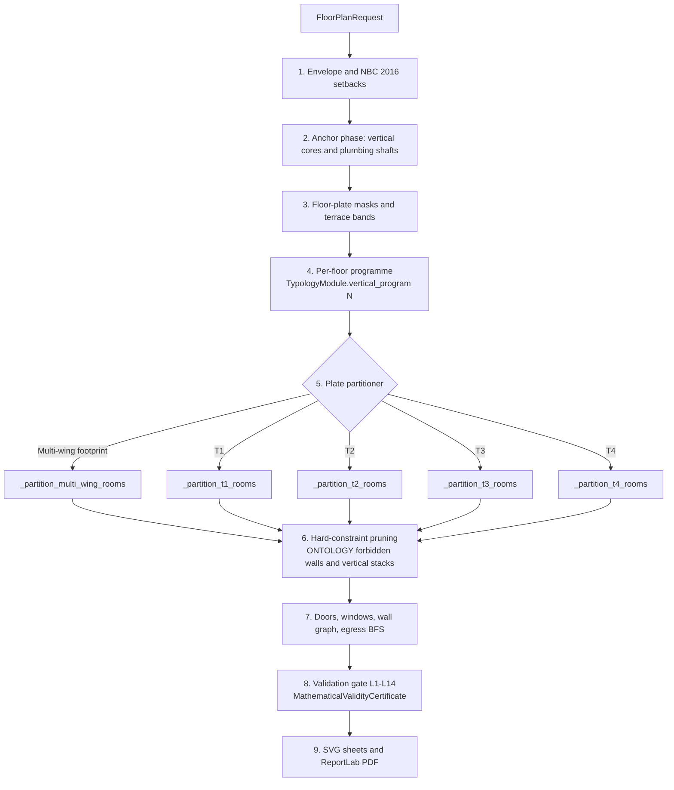

# Generative Blueprint Engine
> `Spatial CSP` • `Ontology Dispatch` • `Vastu Shastra` • `Topological Invariants` • `ReportLab Vector Drawing`

Architecture and mathematical specification of the BuildWise generative architectural floor plan engine (`app/services/floorplan/` and `app/placement/`). Covers the placement knowledge base, topological invariants, the envelope-first plate solver, ontology-driven typology dispatch, the QA gate, and vector PDF rendering.

---

## Table of Contents
- [Engine Pipeline](#engine-pipeline)
- [Architect Placement Knowledge Base](#architect-placement-knowledge-base)
- [Topological Invariants](#topological-invariants)
  - [1. Leaf Rule (Degree == 1)](#1-leaf-rule-degree--1)
  - [2. Peripheral Service Rule](#2-peripheral-service-rule)
  - [3. Central-Box Exclusion](#3-central-box-exclusion)
  - [4. Circulation Hub & Entry Axis](#4-circulation-hub--entry-axis)
  - [5. Forbidden Adjacency Matrix](#5-forbidden-adjacency-matrix)
- [Envelope-First Layout Solver](#envelope-first-layout-solver)
- [Typology Dispatch (Ontology-Driven)](#typology-dispatch-ontology-driven)
  - [Resolution](#resolution)
  - [The Four Dispatch Targets](#the-four-dispatch-targets)
  - [Dispatch Inside the Plate Partitioner](#dispatch-inside-the-plate-partitioner)
  - [Hard-Constraint Pruning](#hard-constraint-pruning)
  - [Module Contract and Sheet Gates](#module-contract-and-sheet-gates)
  - [Extending the Dispatch](#extending-the-dispatch)
- [Deterministic Validation Gate](#deterministic-validation-gate)
- [Vector Blueprint Rendering & PDF Integration](#vector-blueprint-rendering--pdf-integration)
- [Navigation](#navigation)

---

## Engine Pipeline

Floor plan generation is one deterministic pass: the envelope is fixed before any
room exists, the programme comes from the ontology, and the plate either clears
every hard relation or the solve reports why it could not.

---

## Architect Placement Knowledge Base

Defined in `app/placement/kb.py`.

The Knowledge Base codifies Indian residential architectural canon (National Building Code 2016 and Vastu Shastra) as strict typed data models (`RoomPlacementRule`):

| Room Type | Human Title | Preferred Zone | Allowed Bands | Required Adjacency | Forbidden Adjacency | Leaf Node? | Ext. Wall? | Min Area |
|:---|:---|:---|:---|:---|:---|:---:|:---:|:---:|
| **`living`** | Living Room | N, E, NE, Center | Front | Exterior, Corridor | *(None)* | **No** (Hub) | Yes | 18.0 m² |
| **`pooja`** | Pooja Room | NE (Ishanya) | Front, Flank | Living, Corridor | Bath, WC, Kitchen, Bed | **Yes** | Yes | 4.0 m² |
| **`kitchen`** | Kitchen | SE (Agneya) | Rear, Flank | Dining, Living, Corridor | Bath, WC, Pooja, Bed | **Yes** | Yes | 9.0 m² |
| **`master_bed`** | Master Bedroom | SW (Nairutya) | Rear, Flank | Corridor | Kitchen | **Yes** | Yes | 14.0 m² |
| **`bedroom`** | Bedroom | W, NW, S | Rear, Flank | Corridor | Kitchen | **Yes** | Yes | 10.0 m² |
| **`common_bath`**| Common Bath | NW, W | Flank, Rear | Corridor | Pooja, Kitchen, Entry Axis | **Yes** | Yes | 3.5 m² |
| **`attached_bath`**| Attached Bath | W, NW, S | Flank, Rear | Master Bed | Pooja, Kitchen | **Yes** | Yes | 3.5 m² |
| **`wc_utility`** | WC / Utility | NW, W | Flank, Rear | Corridor | Pooja, Kitchen | **Yes** | Yes | 1.5 m² |
| **`dining`** | Dining Area | E, Center | Middle, Front | Kitchen, Living, Corridor | Bath, WC | **No** | No | 8.0 m² |
| **`corridor`** | Corridor | Center | Middle | Living | *(None)* | **No** (Hub) | No | 6.0 m² |

---

## Topological Invariants

The Dissection Engine and Placement Validator enforce 5 non-negotiable architectural invariants:

### 1. Leaf Rule (Degree == 1)
In the circulation door graph, all sanitary spaces (baths, toilets, utilities) and sacred spaces (pooja) must be **leaf nodes**:
$$\text{degree}(v) = 1 \quad \forall v \in \{\text{common\_bath}, \text{attached\_bath}, \text{wc\_utility}, \text{pooja}\}$$
No service space can ever have multiple doors or permit through-traffic between bedrooms or living spaces.

### 2. Peripheral Service Rule
Every bathroom, WC, and kitchen must share at least one edge with the building's exterior envelope:
$$\text{edge}(v) \cap \partial(\text{Envelope}) \neq \emptyset \quad \forall v \in \{\text{service rooms}\}$$
This guarantees natural cross-ventilation, light shafts, and accessible plumbing risers without internal light wells.

### 3. Central-Box Exclusion
The central 40% box of the building envelope represents the core circulation spine (and the *Brahmasthan* under Vastu canon):
$$C_{\text{box}} = [x_{\text{min}} + 0.30W, x_{\text{min}} + 0.70W] \times [y_{\text{min}} + 0.30D, y_{\text{min}} + 0.70D]$$
No service room centroid may lie within this central 40% bounding box:
$$\text{Centroid}(v) \notin C_{\text{box}} \quad \forall v \in \{\text{common\_bath}, \text{wc\_utility}, \text{kitchen}\}$$

### 4. Circulation Hub & Entry Axis
- The **main entry door** must open exclusively into the **Living Room** (or dedicated front foyer).
- The living room serves as the circulation hub connecting to the central corridor spine.
- Under no circumstances may an entrance door open into a bathroom, kitchen, or private bedroom.

### 5. Forbidden Adjacency Matrix
To preserve sanitation and cultural canon, bathrooms/WCs and pooja rooms are strictly prohibited from sharing a wall:
- **Zero Shared Wall Length:** $\text{Wall}(\text{bath}) \cap \text{Wall}(\text{pooja}) = \emptyset$
- **Zero Shared Wall Length:** $\text{Wall}(\text{bath}) \cap \text{Wall}(\text{kitchen}) = \emptyset$

---

## Envelope-First Layout Solver

The plan is produced by `app/services/floorplan/engine.py`, the sole geometry
engine: it subtracts NBC 2016 setbacks from the plot boundary, fills the
resulting envelope with rectangular rooms, and rejects any layout that does not
tile it.

`tests/test_floorplan.py::test_dissection_engine_contiguity_and_no_voids` pins
the tiling contract — 100% envelope coverage, no interior voids, and no
overlapping room rectangles. `csp_engine.py` holds the earlier backtracking
constraint solver; it is retained for the single-floor regression tests and is
not on the engine's path.

---

## Typology Dispatch (Ontology-Driven)

`SoleGeometryEngine` (`app/services/floorplan/engine.py`) is the single geometry
path for every typology and every storey count. It stores no plates: the request
resolves to one of four canonical typologies and one partitioning loop runs over
ontology data. Templates A/B/C, the guillotine fallback and the low-strictness
canonical template are gone — a plate either satisfies the ontology's hard
relations or the solve fails with an explicit reason.

### Resolution

`__init__` resolves `request.building_typology` through `ONTOLOGY.get_typology(...)`
and keeps `profile.canonical`. Free-text values (`apartment`, `duplex`,
`commercial`, `office`, `warehouse`, …) normalize inside the `TypologyProfile`
matching in `app/services/floorplan/ontology.py`; anything unrecognised —
including bare `residential` — resolves to `T1_SINGLE_FAMILY`.

The canonical key then selects exactly three inputs:

| Input | Consumed by | Source |
|:---|:---|:---|
| Per-level programme | `_resolve_floor_program` | `get_typology_module(self.typology).vertical_program(N)` |
| Storey height, egress travel limit, parking ratio | `_lock_vertical_anchors`, `_verify_egress_and_circulation`, `_compute_statutory_compliance`, wall graph | `TypologyProfile.floor_height_m`, `.egress_constants`, `.parking_table` |
| Plate topology | `_partition_floor_plate` | `_partition_t1_rooms` … `_partition_t4_rooms` |

Everything else — minimum areas and widths, hygiene classes, Vastu zone weights,
forbidden adjacencies, vertical stacking bans — is read from the `SpaceTypeSpec`
records in the same ontology. Switching typology changes the programme and the
partitioner, not the rule set.

### The Four Dispatch Targets

All four modules implement `TypologyModuleProtocol`
(`app/services/floorplan/typologies/protocol.py`) and answer `vertical_program(N)`
with the space ids each level is programmed for. The partitioners emit their leaf geometry;
aggregate ids such as `apt_unit_1`, `open_office` and `racked_storage` are programme
concepts and never become rooms.

| Typology | Programme per level | Depth | Partitioner |
|:---|:---|:---:|:---|
| **T1** `T1_SINGLE_FAMILY` `T1ResidenceModule` | G — `foyer · living · dining · kitchen · utility · puja · bath_1` (a single-storey request adds `master_bed`); G+1 — `central_lobby · master_bed · bed_2 · bath_master · bath_2 · balcony · study`; G+2 — `master_bed · bed_2 · bath_master · bath_2 · balcony` | 1–3 | `_partition_t1_rooms` |
| **T2** `T2_FAMILY_APARTMENT` `T2ApartmentModule` | G — `floor_lobby · apt_unit_1 · apt_unit_2 · guard_house`; G+1 and above — `floor_lobby · apt_unit_1 · apt_unit_2`, emitted as `t2_unitA_*` / `t2_unitB_*` leaves | 1–4 | `_partition_t2_rooms` |
| **T3** `T3_LARGE_COMPLEX` `T3ComplexModule` | G — `reception · visitor_lounge · conference_room · sanitary_block · server_room · electrical_room`; upper — `spine_corridor · open_office · private_office · meeting_room · sanitary_block · pantry`, emitted as `t3_suite_*` leaves | 1–4 | `_partition_t3_rooms` |
| **T4** `T4_WAREHOUSE` `T4WarehouseModule` | G — `dock_bay · dispatch · heavy_bay · racked_storage · worker_amenity · guard_house`; mezzanine (+3.60 m) — `admin_catwalk · admin_office · conf_room` | 1–2 | `_partition_t4_rooms` |

`Depth` is the clamp inside each module's `vertical_program`; the engine itself
bounds a request to 1–4 storeys, and any level past the table reuses the last
programme entry.

### Dispatch Inside the Plate Partitioner

`_partition_floor_plate` takes the first matching branch, in this order:

1. **Multi-wing footprint** — when `site_plan.footprint.wings` holds more than one
   wing (L-shape or courtyard plot), `_partition_multi_wing_rooms` builds the
   wing-by-wing plate and the typology partitioner is skipped.
2. **Single-storey T1 with a client programme** — a one-storey T1 request carrying
   at least three `required_rooms` goes straight to `_partition_t1_rooms`, whose
   4- to 8-room arrangements key on the requested room names.
3. **Default** — the vertical core and its lobby spine are locked first (the name
   follows the typology: Entrance Foyer, Central Distribution Lobby, Double-Loaded
   Spine Corridor, Mezzanine Access Catwalk), then `self.typology` selects
   `_partition_t{1..4}_rooms` for the remaining plate.

### Hard-Constraint Pruning

Every branch ends in `_prune_and_verify_hard_constraints`, which rejects room
overlap, shared walls that `ONTOLOGY.is_forbidden_wall` bans
(HYG-01 foul against sacred, HYG-02 foul against food), `FloorLoad.HEAVY` on any
upper level (VERT-04), and wet-over-habitable stacking through
`ONTOLOGY.evaluate_vertical_stack` (VERT-02). These raise; there is no retry with a
different template. An envelope that cannot hold the programme returns a failed
`MultiStoreyBuildingModel` with `unmet_requirements` instead of a canned plan.

### Module Contract and Sheet Gates

| Member | Returns | Read by |
|:---|:---|:---|
| `catalog()` | `SpaceTypeSpec` map resolved from `ONTOLOGY` | tests; the engine queries the ontology directly |
| `vertical_program(N)` | per-level `space_ids` and label | `_resolve_floor_program`, unmet-requirements ledger |
| `layout_strategy()` | zoning bands, T2 50/50 unit split, T3 1.50 m corridor, T4 6 m bays, 3.60 m apron and +3.60 m mezzanine | tests — the partitioners realise those bands as fixed constants today |
| `sheet_gates()` | optional drawing layers: Vastu diagram (T1, T2), unit schedule (T2, T3), column grid with dock apron and mezzanine section (T4); egress and dimension chains always on | tests |
| `compose_sheet(level_plan, theme)` | SVG through the shared drawing IR | tests; the engine's sheet loop calls `generate_multi_floor_blueprint_svg` directly so each sheet can carry the L1–L14 gate table |

### Extending the Dispatch

A new room type is a data change: add a `SpaceTypeSpec` to `UNIVERSAL_SPACE_CATALOG`
(47 entries today) and list its id in the typology module's `_GROUND_IDS` or
`_UPPER_IDS`. Its relations to every other space follow from its attributes through
`derive_spatial_rules` — hygiene, emissions, security and floor load generate the
rule ids, so a new cleanroom inherits the foul-vs-sacred wall ban and the
wet-over-habitable stacking ban without touching the engine.
`tests/test_ontology.py::test_zero_solver_change_extensibility` pins that contract.

---

## Deterministic Validation Gate

Defined in `app/services/floorplan/validation_gate.py`.

Every generation — any typology, any floor count — is judged by the same L1–L14
layer stack: geometry and statutory invariants, door swings, fixture and furniture
clearances, naming honesty, stairs, Vastu scoring, program intent, ventilation, wet
cores and plumbing, terrace drainage, structure, accessibility, and fire/egress. No
layer is skipped: one that does not apply is recorded as N/A with an explicit
reason, and N/A never makes a plan invalid on its own. The overall status is the
worst layer (FAIL > WARN > PASS).

---

## Vector Blueprint Rendering & PDF Integration

The blueprint engine generates two presentation formats:

### 1. Interactive Web SVG (`app/services/floorplan/svg_generator.py`)
- Scalable vector graphics rendered dynamically in `BlueprintViewer.tsx`.
- Architectural hatching, swing door arcs, dimension ticks, room labels, area callouts, and North arrow orientation.

### 2. High-Resolution PDF Vector Drawing (`app/services/report_service.py`)
- Generated via `draw_floorplan_reportlab()`.
- Renders directly onto a dedicated page in the formal engineering report using ReportLab vector primitives (`Rect`, `Line`, `ArcPath`, `String`).
- Scaled to the full page content width (174mm) accompanied by a 4-tile solver metric strip and color-coded room legend.

---

## Navigation
- **Previous:** [← AI Pipeline & Adapters](ai-pipeline.md)
- **Next:** [Map & Data Providers →](map-and-data.md)

---
*BuildWise AI • [MIT License](../LICENSE) • Copyright (c) 2026 Rolan Lobo*
