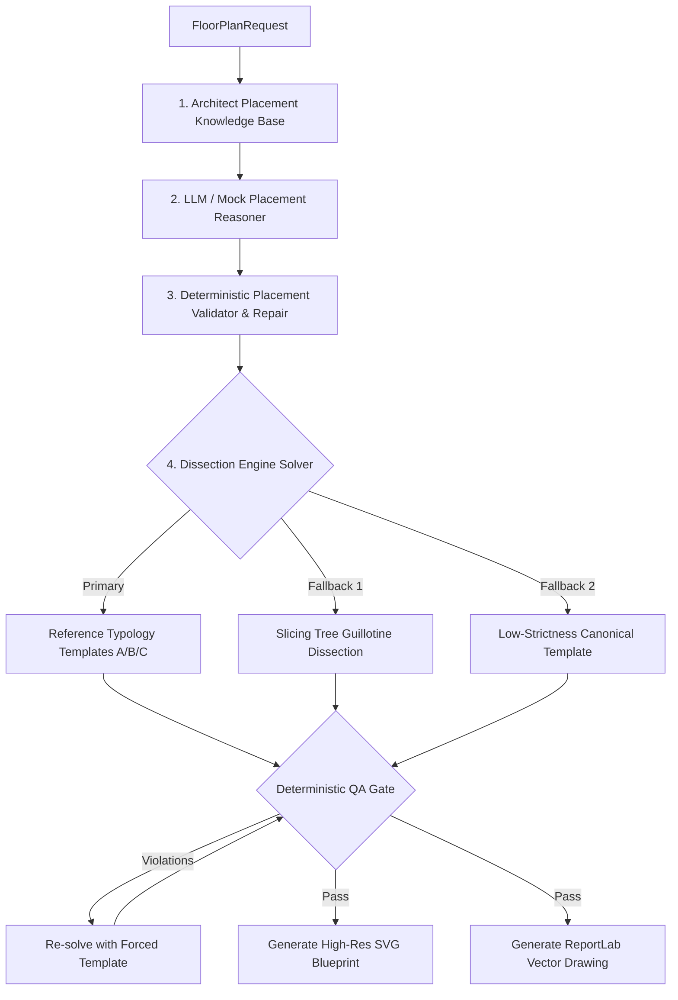

# Generative Blueprint Engine
> `Spatial CSP` • `Dissection Engine` • `Vastu Shastra` • `Topological Invariants` • `ReportLab Vector Drawing`

Architecture and mathematical specification of the BuildWise generative architectural floor plan engine (`app/services/floorplan/` and `app/placement/`). Covers the placement knowledge base, topological invariants, the slicing-tree dissection solver, canonical reference templates, the QA gate, and vector PDF rendering.

---

## Table of Contents
- [Engine Pipeline](#engine-pipeline)
- [Architect Placement Knowledge Base](#architect-placement-knowledge-base)
- [Topological Invariants](#topological-invariants)
  - [1. Leaf Rule (Degree == 1)](#1-leaf-rule-degree--1)
  - [2. Peripheral Service Rule](#2-peripheral-service-rule)
  - [3. Central-Box Exclusion](#3-central-box-exclusion)
  - [4. Circulation Hub & Entry Axis](#4-circulation-hub--entry-axis)
  - [5. Forbidden Adjacency Matrix](#5-forbidden-adjacency-matrix)
- [Slicing-Tree Dissection Solver](#slicing-tree-dissection-solver)
- [Reference Typology Templates](#reference-typology-templates)
  - [Template A: Single-Family 5-Room](#template-a-single-family-5-room)
  - [Template B: Family 6-Room](#template-b-family-6-room)
  - [Template C: Executive Multi-Room (7+ Rooms / 2 Baths)](#template-c-executive-multi-room-7-rooms--2-baths)
- [Deterministic QA Gate](#deterministic-qa-gate)
- [Vector Blueprint Rendering & PDF Integration](#vector-blueprint-rendering--pdf-integration)
- [Navigation](#navigation)

---

## Engine Pipeline

Floor plan generation follows a 4-stage pipeline that guarantees architectural sanity before geometry is generated:

---

## Architect Placement Knowledge Base

Defined in `app/placement/kb.py`.

The Knowledge Base codifies Indian residential architectural canon (National Building Code 2016 and Vastu Shastra) as strict typed data models (`RoomPlacementRule`):

| Room Type | Human Title | Preferred Zone | Allowed Bands | Required Adjacency | Forbidden Adjacency | Leaf Node? | Ext. Wall? | Min Area |
|:---|:---|:---|:---|:---|:---|:---:|:---:|:---:|
| **`living`** | Living Room | N, E, NE, Center | Front | Exterior, Corridor | *(None)* | **No** (Hub) | Yes | 18.0 m² |
| **`pooja`** | Pooja Room | NE (Ishanya) | Front, Flank | Living, Corridor | Bath, WC, Kitchen, Bed | **Yes** | Yes | 4.0 m² |
| **`kitchen`** | Kitchen | SE (Agneya) | Rear, Flank | Dining, Living, Corridor | Bath, WC, Pooja, Bed | **Yes** | Yes | 9.0 m² |
| **`master_bed`** | Master Bedroom | SW (Nairutya) | Rear, Flank | Corridor | Kitchen | **Yes** | Yes | 14.0 m² |
| **`bedroom`** | Bedroom | W, NW, S | Rear, Flank | Corridor | Kitchen | **Yes** | Yes | 10.0 m² |
| **`common_bath`**| Common Bath | NW, W | Flank, Rear | Corridor | Pooja, Kitchen, Entry Axis | **Yes** | Yes | 3.5 m² |
| **`attached_bath`**| Attached Bath | W, NW, S | Flank, Rear | Master Bed | Pooja, Kitchen | **Yes** | Yes | 3.5 m² |
| **`wc_utility`** | WC / Utility | NW, W | Flank, Rear | Corridor | Pooja, Kitchen | **Yes** | Yes | 1.5 m² |
| **`dining`** | Dining Area | E, Center | Middle, Front | Kitchen, Living, Corridor | Bath, WC | **No** | No | 8.0 m² |
| **`corridor`** | Corridor | Center | Middle | Living | *(None)* | **No** (Hub) | No | 6.0 m² |

---

## Topological Invariants

The Dissection Engine and Placement Validator enforce 5 non-negotiable architectural invariants:

### 1. Leaf Rule (Degree == 1)
In the circulation door graph, all sanitary spaces (baths, toilets, utilities) and sacred spaces (pooja) must be **leaf nodes**:
$$\text{degree}(v) = 1 \quad \forall v \in \{\text{common\_bath}, \text{attached\_bath}, \text{wc\_utility}, \text{pooja}\}$$
No service space can ever have multiple doors or permit through-traffic between bedrooms or living spaces.

### 2. Peripheral Service Rule
Every bathroom, WC, and kitchen must share at least one edge with the building's exterior envelope:
$$\text{edge}(v) \cap \partial(\text{Envelope}) \neq \emptyset \quad \forall v \in \{\text{service rooms}\}$$
This guarantees natural cross-ventilation, light shafts, and accessible plumbing risers without internal light wells.

### 3. Central-Box Exclusion
The central 40% box of the building envelope represents the core circulation spine (and the *Brahmasthan* under Vastu canon):
$$C_{\text{box}} = [x_{\text{min}} + 0.30W, x_{\text{min}} + 0.70W] \times [y_{\text{min}} + 0.30D, y_{\text{min}} + 0.70D]$$
No service room centroid may lie within this central 40% bounding box:
$$\text{Centroid}(v) \notin C_{\text{box}} \quad \forall v \in \{\text{common\_bath}, \text{wc\_utility}, \text{kitchen}\}$$

### 4. Circulation Hub & Entry Axis
- The **main entry door** must open exclusively into the **Living Room** (or dedicated front foyer).
- The living room serves as the circulation hub connecting to the central corridor spine.
- Under no circumstances may an entrance door open into a bathroom, kitchen, or private bedroom.

### 5. Forbidden Adjacency Matrix
To preserve sanitation and cultural canon, bathrooms/WCs and pooja rooms are strictly prohibited from sharing a wall:
- **Zero Shared Wall Length:** $\text{Wall}(\text{bath}) \cap \text{Wall}(\text{pooja}) = \emptyset$
- **Zero Shared Wall Length:** $\text{Wall}(\text{bath}) \cap \text{Wall}(\text{kitchen}) = \emptyset$

---

## Slicing-Tree Dissection Solver

Implemented in `app/services/floorplan/dissection_engine.py` via `DissectionEngine`.

Instead of unconstrained random packing, the solver treats the building envelope as a continuous 2D polygon and recursively dissects it into rooms using a **Slicing Tree (Guillotine Partition)**:
1. **Envelope Calculation:** Subtracts setbacks (front, rear, flanks per NBC 2016) from the plot boundary to establish the bounding envelope.
2. **Band Allocation:** Slices the envelope along the depth axis into three contiguous functional bands:
   - **Front Band:** Public spaces (Living, Foyer, Pooja).
   - **Middle Band:** Circulation corridor and dining buffer.
   - **Rear / Flank Bands:** Private bedrooms and peripheral service spaces.
3. **Recursive Guillotine Cuts:** Recursively cuts each band horizontally or vertically according to the target room areas.
4. **Dimension Clamping:** Enforces minimum room dimensions (Living $\ge 3.5\text{ m}$, Bedrooms $\ge 3.0\text{ m}$, Pooja $\ge 2.4\text{ m}$) and maximum aspect ratio ($\le 1:2.2$).

---

## Reference Typology Templates

When standard plots or common room combinations are requested, the engine dispatches to pre-validated canonical templates:

### Template A: Single-Family 5-Room
- **Rooms:** Living, Pooja, Master Bedroom, Bath 1, Kitchen.
- **Layout:**
  - Front: Living (NW-Center) + Pooja (NE corner).
  - Rear: Master Bed (SW corner) + Bath 1 (W flank) + Kitchen (SE corner).
  - Corridor: Central strip connecting Living to Master Bed, Bath, and Kitchen.

### Template B: Family 6-Room
- **Rooms:** Living, Pooja, Master Bedroom, Bedroom 2, Bath 1, Kitchen.
- **Layout:**
  - Front: Living (N) + Pooja (NE).
  - Middle: Circulation Corridor.
  - Rear: Master Bed (SW) + Bedroom 2 (NW) + Common Bath (W flank) + Kitchen (SE).

### Template C: Executive Multi-Room (7+ Rooms / 2 Baths)
- **Rooms:** Living, Pooja, Master Bed, Bedroom 2, Attached Bath, Common Bath, Dining, Kitchen.
- **Layout:**
  - Front: Living + Pooja + Dining.
  - Core: Central Corridor spine.
  - Flanks: Common Bath (NW exterior) + Attached Ensuite (SW exterior connected to Master Bed).
  - Rear: Master Bed (SW) + Bed 2 (S) + Kitchen (SE).

---

## Deterministic QA Gate

Defined in `app/services/floorplan/constraints.py` (`evaluate_solver_qa`).

Every generated floor plan must pass an automated structural QA audit before being serialized:
- [x] **Overlap Check:** Room bounding boxes must have zero area intersection.
- [x] **Envelope Containment:** Every room must reside 100% within the building envelope.
- [x] **Door Graph Connectivity:** All rooms must have a valid BFS path to the main entrance door.
- [x] **Invariant Verification:** Leaf degree, peripheral wall contact, and pooja isolation verified.

If any check fails, the layout is automatically rejected and re-solved with a forced canonical reference template.

---

## Vector Blueprint Rendering & PDF Integration

The blueprint engine generates two presentation formats:

### 1. Interactive Web SVG (`app/services/floorplan/svg_generator.py`)
- Scalable vector graphics rendered dynamically in `BlueprintViewer.tsx`.
- Architectural hatching, swing door arcs, dimension ticks, room labels, area callouts, and North arrow orientation.

### 2. High-Resolution PDF Vector Drawing (`app/services/floorplan/dissection_engine.py`)
- Generated via `draw_floorplan_reportlab()`.
- Renders directly onto a dedicated page in the formal engineering report using ReportLab vector primitives (`Rect`, `Line`, `ArcPath`, `String`).
- Scaled to the full page content width (174mm) accompanied by a 4-tile solver metric strip and color-coded room legend.

---

## Navigation
- **Previous:** [← AI Pipeline & Adapters](ai-pipeline.md)
- **Next:** [Map & Data Providers →](map-and-data.md)

---
*BuildWise AI • [MIT License](../LICENSE) • Copyright (c) 2026 Rolan Lobo*
